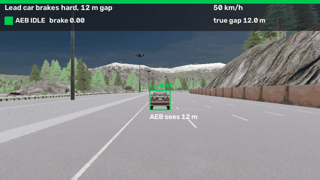
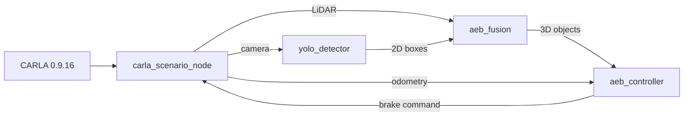
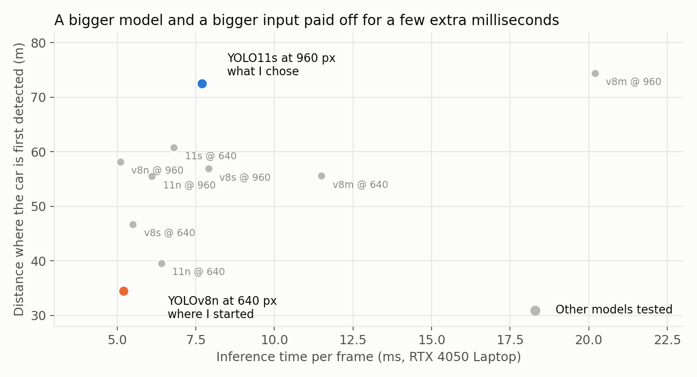

# Autonomous emergency braking on ROS 2 and CARLA

This project is an emergency braking system for a car, built from separate ROS 2 nodes and tested in the CARLA simulator with Euro NCAP style scenarios. A YOLO detector finds the car ahead in the camera image, a fusion node measures how far away it is using LiDAR, and a controller decides when to warn and when to brake. Every run can be recorded to a rosbag and checked afterwards.

I started with a CARLA project that worked in one big script and wanted to see what happens when it is split into proper ROS 2 pieces and held to honest measurements. The short version is that the first working version looked fine in a demo and hid several real problems. Most of this README is about finding those problems and what fixed them.

Everything here runs on one laptop with an RTX 4050 and 6 GB of VRAM, Ubuntu 24.04, ROS 2 Jazzy and CARLA 0.9.16.

## See it run

These clips are rebuilt from the camera frames recorded in the rosbags. The green box is YOLO, "AEB sees" is the range the fusion node reports, and the coloured strip and text show what the controller is doing. "True gap" comes from the simulator and is only there to check the AEB against.

In the first run the ego car drives at 50 km/h towards a parked car. The AEB starts braking at about 36 m and stops 11.7 m short.


The second run is the hardest scenario I set up. The lead car is only 12 m ahead and brakes hard at 6 m/s2. The AEB reacts and cuts the impact speed from 50 to 25 km/h, but it does not avoid the crash.



## How it works



There are four packages.

`aeb_detector` runs YOLO11s at 960 px and publishes 2D boxes. `aeb_fusion` projects the LiDAR points into each box and takes the depth of the nearest cluster, which gives a 3D position for the car. `aeb_controller` is a ROS 2 lifecycle node. It tracks the range over the last second, works out how fast the gap is closing, and decides what to do. `aeb_bringup` holds the launch file, the scenario definitions, the CARLA bridge that talks to the simulator, rosbag recording and the launch tests.

Safety critical commands use a reliable QoS profile and sensor streams use best effort with a queue of one, so a slow consumer never works from stale data. The controller also goes by the timestamp on each message, not the time it arrived, because queueing jitter at 14 m/s looks like metres of range noise.

### How the controller decides

The controller does not use fixed time-to-collision thresholds. Every cycle it asks how hard the car would have to brake right now to stop before the target, allowing for the response delay and a safety margin. It compares that with the most the car can actually deliver, which I measured at 4.5 m/s2 (the simulated brakes give about 0.67 + 3.83 times the brake command).

Below 30 percent of that limit it stays idle. Above it, it warns. From 65 percent it brakes with a pedal level that follows the demand, and from 90 percent, sustained for 0.3 s, it brakes fully. Two things stop it from reacting to noise: a braking state has to hold for a short time before it is entered, and a hard braking lead car only counts once the estimate is confirmed. If the threat goes away for a second the brake releases, and the brake level also decays slowly as the demand falls instead of staying at its peak.

## What the results say

I ran ten scenarios: seven collision scenarios in the style of Euro NCAP car-to-car rear tests, and three false-positive checks where the AEB must stay quiet. Each was run once on the final version, so these are single runs and not a pass rate yet.

| Scenario | What happens | Result | First brake | Stops short by |
|---|---|---|---|---|
| Stationary target, 20 km/h | ego approaches a parked car | pass | 8.5 m | 7.0 m |
| Stationary target, 30 km/h | same | pass | 15 m | 8.9 m |
| Stationary target, 40 km/h | same | pass | 23 m | 11.2 m |
| Stationary target, 50 km/h | same | pass | 36 m | 11.7 m |
| Slow lead car | ego at 50, lead at 20 km/h | pass | 16 m | 3.2 m |
| Braking lead car | both at 50, lead brakes at 2 m/s2 | pass | 19 m | 4.6 m |
| Hard braking lead car | both at 50, 12 m gap, lead brakes at 6 m/s2 | **collision at 25 km/h** | 11 m | not avoided |
| Empty road | 12 s at 50 km/h, nothing ahead | pass, no brake | none | not applicable |
| Car in the next lane | ego drives past a parked car 3.5 m to the side | pass, no brake | none | not applicable |
| Close following | lead car 15 m ahead at the same speed | pass, no brake | none | not applicable |

Nine of the ten behave correctly. The false-positive checks are the part I would not skip: it is easy to build something that brakes in every test and call it safe.

### The detector was not the whole problem

My first detector was YOLOv8n at its default 640 px input. It only picked the car up at about 34 m. I benchmarked ten combinations of model and input size on the frames recorded from earlier runs, using the true gap from the simulator to measure how far away each model first saw the car.



YOLO11s at 960 px sees the car from about 72 m and costs 7.7 ms per frame, only a couple of milliseconds more than where I started. The larger YOLOv8m reaches about the same range but takes 20 ms. A caveat: the benchmark used three clips of one car on one map, so treat the numbers as a guide and not a ranking.

### Fusion was quietly throwing the detections away

Even with the better detector, the AEB only started tracking the car at around 25 m. YOLO was detecting it in 100 percent of frames at every distance, but the fusion node was dropping most of those detections.

The reason is that at 40 m the car is only about 20 pixels wide, and fusion only used the middle half of the box and demanded at least three LiDAR points inside it. A 32 channel LiDAR often has fewer than that on a distant car. I replayed the recorded LiDAR and boxes through seven variants offline before touching the live system. Just loosening the thresholds made it worse, because stray road and background points pulled the median out by about a metre. Taking the full box and the median of the nearest cluster of points fixed both problems.


After the change fusion produces a range in 98 percent of frames at 35 to 45 m, up from 8 percent. The range error stays around 0.2 to 0.3 m.

### The controller had its own problems

With perception fixed, the controller was the limit. The recorded bags showed that its estimate of the target's deceleration was far noisier than I assumed. When the true value was zero, the estimate had a standard deviation of 0.7 to 1.8 m/s2 and spiked above my 0.5 m/s2 threshold in up to 40 percent of samples. For a slow moving lead car the controller kept deciding the car ahead was braking and started braking itself about 16 m too early, and because the brake was latched at its peak it stayed there until it stopped.

The fixes were the ones described above: confirm the deceleration estimate before using it, require braking states to be sustained, let the brake release and decay, and widen the gap between the partial and full braking thresholds. I screened thresholds in an offline simulation of the real controller before spending simulator time, and then checked every change against CARLA.


The slow lead car now ends 3.2 m behind its target instead of 20.7 m, and the braking lead 4.6 m instead of 16.6 m.

Here are the two runs from the clips above as time series. On the left the brake comes on at once, then decays as the demand falls, and the final jump is the brake being held after the car has stopped. On the right the lead car starts braking at 1.0 s but the controller cannot see enough closing speed to act until about 1.6 s.


## What is still not good

The hard braking lead car still collides, at half the original speed. That one is limited by how quickly the tracker can see a lead car start to brake, so improving it needs earlier cues than range alone, such as brake lights or radar velocity.

The stationary target runs stop 7 to 12 m short. That is a deliberate trade. A car that brakes at 4.5 m/s2 needs about 21 m to stop from 50 km/h before any margin, and my offline simulation showed that braking any later collided under plausible model errors such as weaker brakes or extra delay. Real cars brake much harder, so a real system could wait longer.

Other limits worth knowing. Every result is a single run, so there is no pass rate or confidence interval yet. It is all simulation, with one car model, one map and no weather. False positives were only tested in three situations, and I have not tried pedestrians, curves, cut-ins, shadows or oncoming traffic. My offline simulation agrees with CARLA on when braking starts but is optimistic about stopping distance, so I only used it to screen options.

## Things I got wrong along the way

A few of the mistakes changed the results, so they are worth being open about.

One scenario reported a pass while the ground-truth gap was negative. The target was not actually in the ego car's lane, so the car drove past it. I replaced the guessed car length with a gap measured from the bounding boxes, placed the target along the ego heading, and made the harness fail loudly when the start geometry is off or when two cars overlap without a collision event.

Another early collision turned out to be a start-up race. YOLO takes about three seconds to produce its first result, and the scenario had already started. The detector now warms up before it subscribes, and the scenario waits until every node is ready.

I also believed for a while that the partial brake stage was over-braking, based on a deceleration fit that included the spikes at impact. Fitting again with medians showed the brake map is linear and the old mapping was about right. And I once narrowed the gap between the partial and full thresholds because my simulation said it was safe, which made the real controller jump to full braking within a fraction of a second on every stationary run.

## Running it

Set up once.

```bash
source /opt/ros/jazzy/setup.bash
cd ~/projects/aeb_ws
python3 -m venv --system-site-packages .venv
source .venv/bin/activate
pip install -r requirements.txt
pip install ~/CARLA_0.9.16/PythonAPI/carla/dist/carla-0.9.16-cp312-*.whl
python -m colcon build --symlink-install
source install/setup.bash
```

Build with `python -m colcon` so the entry points use the venv interpreter. The system Python cannot import `carla`.

Start CARLA, then run scenarios. Keep the quality on Low, because a 6 GB card is tight.

```bash
~/CARLA_0.9.16/CarlaUE4.sh -quality-level=Low -RenderOffScreen -nosound &
scripts/run_scenarios.sh CCRs_50 CCRb_50_d6 FP_none
```

`WATCH=1` adds a chase camera with a live readout and works with a windowed CARLA (`-windowed -ResX=1280 -ResY=720`). `RECORD=1` writes a rosbag for each run into `bags/`. The script loads Town04 before starting the pipeline, because switching maps with YOLO already on the GPU crashed the 6 GB card once.

Check the results from the bags and rebuild the charts and clips.

```bash
python scripts/analyze_bags.py bags
python scripts/make_pov_gif.py
/usr/bin/python3 scripts/make_charts.py     # matplotlib lives in the system Python
```

One chart compares the final run against an older one, so `make_charts.py` expects that older run in a local `bags_v7/` folder. Bags are not committed because they are about 3 GB per run.

The tests need no simulator.

```bash
python -m pytest src/aeb_controller/test/test_state_machine.py src/aeb_controller/test/test_tracking.py \
  src/aeb_fusion/test/test_geometry.py src/aeb_bringup/test/test_aeb_lifecycle.py \
  src/aeb_bringup/test/test_scenario_math.py
```

That is 47 tests. They cover the controller logic, the tracker, the fusion geometry and the controller's lifecycle transitions through `launch_testing`. The auto-generated flake8 and pep257 stubs that `ros2 pkg create` adds enforce ROS style and are not part of this list.

## What is in the repository

```
src/aeb_detector/     YOLO node
src/aeb_fusion/       fusion node and geometry.py (nearest cluster depth)
src/aeb_controller/   lifecycle node, tracking.py, state_machine.py
src/aeb_bringup/      launch file, scenarios.yaml, params, CARLA bridge, tests
scripts/              run_scenarios.sh, analyze_bags.py, controller_sim.py, make_charts.py, make_pov_gif.py
benchmarks/           detector benchmark, offline fusion test, and their CSV results
docs/media/           charts and clips used in this README
```

`controller_sim.py` is the offline controller simulation I used to screen thresholds. It uses the measured brake map and the measured estimate noise. Run it with `validate` to compare it against the last recorded CARLA results.

## What comes next

The next job is a repeated-run regression test: run each scenario many times, report the pass rate with a confidence interval, and wire the pass or fail check into `launch_testing` so it can run in CI. After that I want a faster reaction to a hard braking lead car, and a sweep over QoS settings and DDS implementations to see whether the middleware configuration changes the safety outcome. That last one is the part I think is most worth writing up properly.

Licensed under Apache 2.0.
